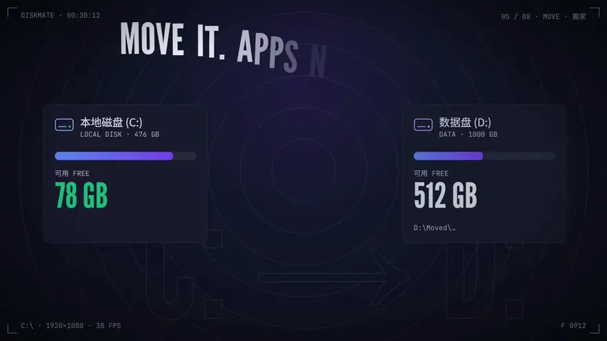
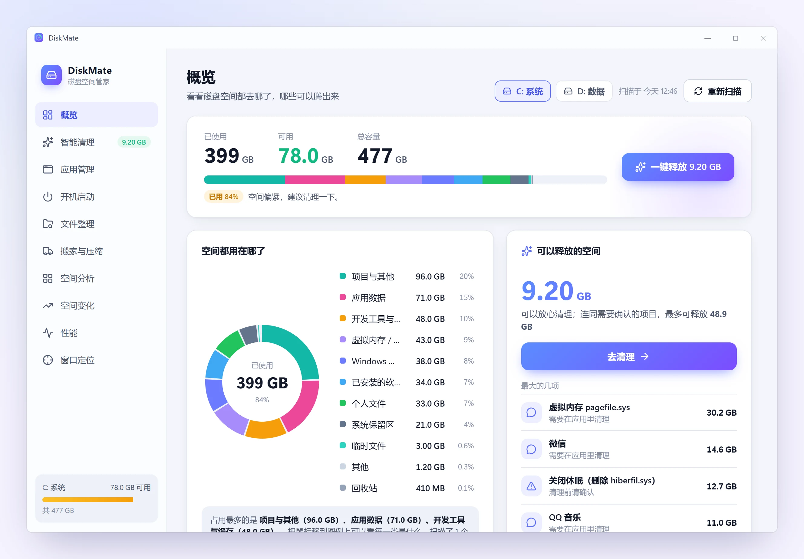
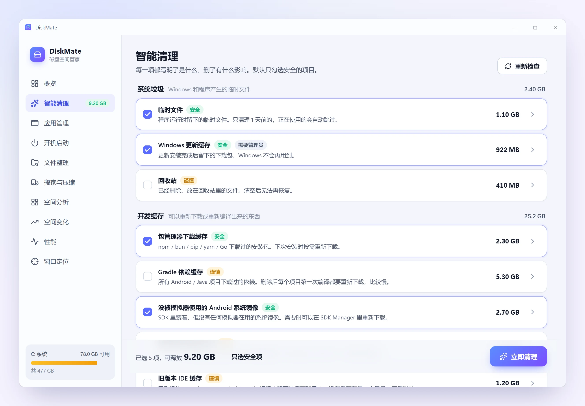
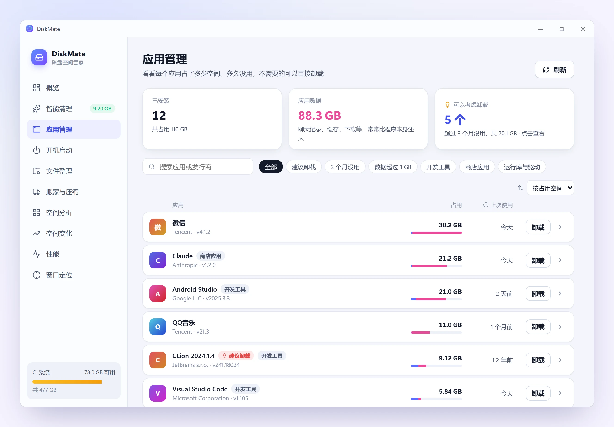
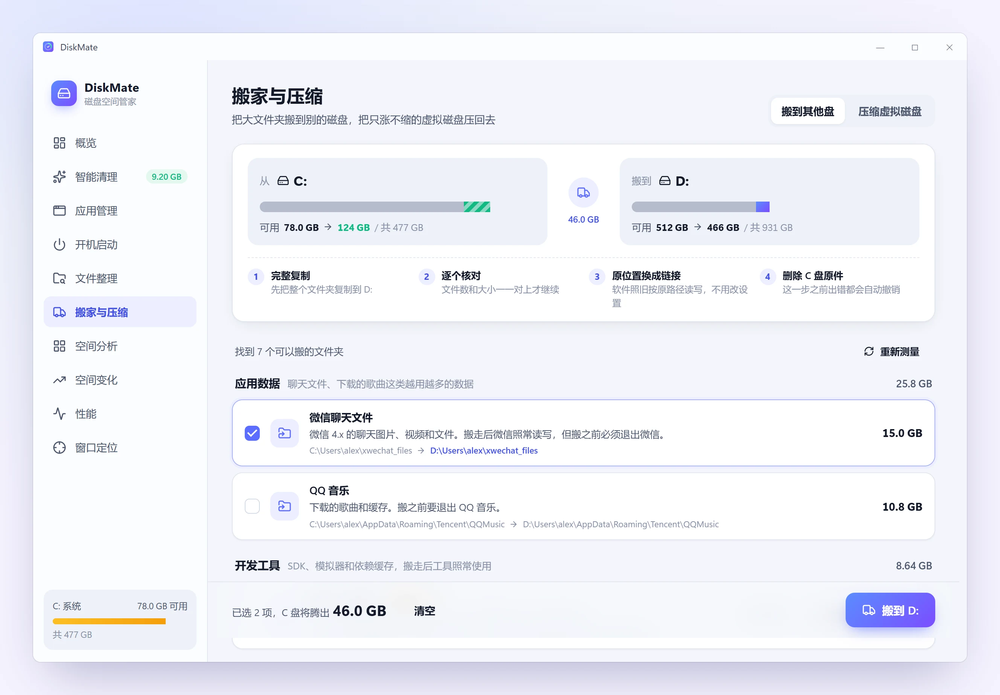
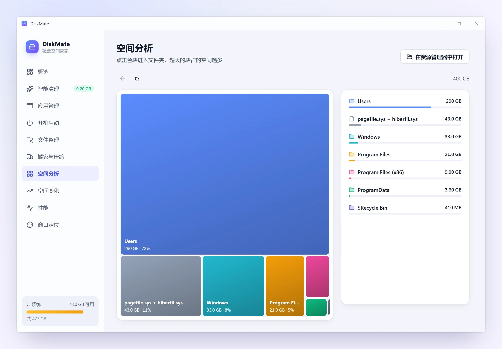
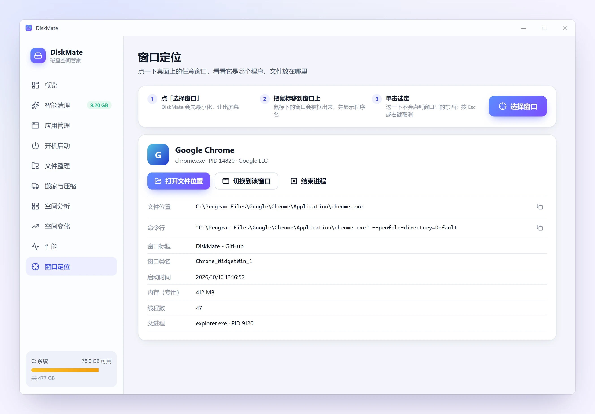
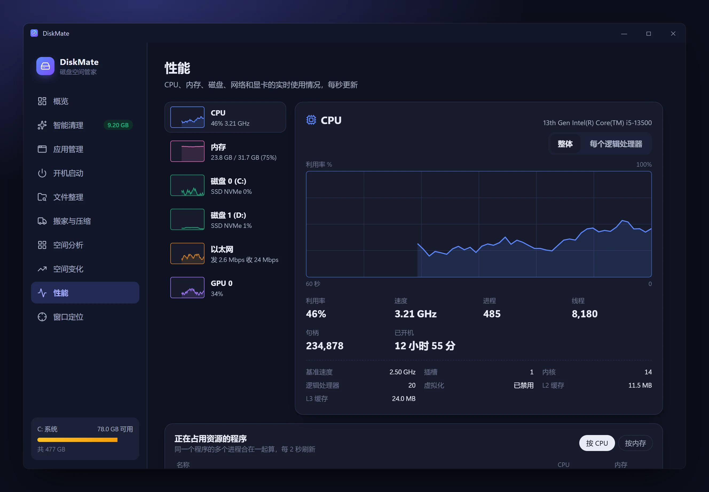
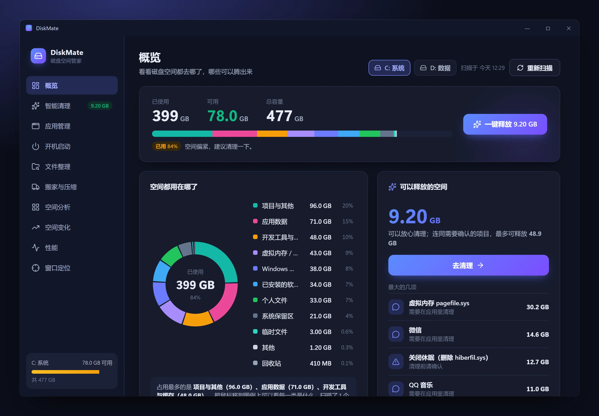

<div align="center">


# DiskMate

**看清 C 盘都去哪了，放心地腾出空间**

Windows 磁盘分析与清理工具 · 开源免费 · 安装包 2.6 MB · 不常驻、不打扰

[](https://github.com/cjxhaaa/diskmate/releases/latest)
[](LICENSE)


[下载](https://github.com/cjxhaaa/diskmate/releases/latest) ·
[功能](#功能) ·
[截图](#截图) ·
[常见问题](#常见问题) ·
[English](README.en.md)

<a href="#介绍视频"></a>

<sub>▶ 1 分钟完整介绍视频（有声音）在<a href="#介绍视频">下方</a></sub>

</div>

## 介绍视频

https://github.com/user-attachments/assets/2995b658-9f1d-45e8-a079-6bb701320412

<sub>60 秒中英双语介绍，画面和配乐全部由代码生成。</sub>

## 为什么做 DiskMate

500 GB 的 C 盘怎么总是不够用？常见的清理软件要么只删临时文件，要么「一键加速」却不告诉你删了什么，还常驻后台弹窗推广。

DiskMate 的想法很简单：

- **先把账算清楚**：每个 GB 去了哪个类别、哪个文件夹、哪个程序，一目了然；
- **再让你自己决定删什么**：每一项都写明是什么、删了有什么影响，标出「安全 / 谨慎 / 需确认」，默认只勾安全的；
- **不打扰你**：没有广告、没有后台常驻服务、不加开机启动，后台工作一律低优先级。

它对开发者特别友好：Gradle、Android SDK 与模拟器、node_modules、Rust target、各种包管理器缓存、闲置的 Git worktree、只涨不缩的 WSL / Docker 虚拟磁盘……这些往往才是 C 盘真正的大头。

## 功能

| | 功能 | 能帮你做什么 |
|---|---|---|
| 📊 | **概览** | 磁盘按类别分账：系统、软件、开发工具与缓存、应用数据、个人文件、虚拟内存 / 休眠……鼠标移上去解释每一类是什么 |
| 🧹 | **智能清理** | 系统垃圾、开发缓存、浏览器缓存、旧版 IDE 数据、闲置 worktree 等，分组列出，逐项说明影响，清理后显示实际释放了多少 |
| 📦 | **应用管理** | 每个应用的程序大小 + 它藏在 AppData 里的数据大小 + 上次使用时间；调用自带卸载程序，卸完再帮你清掉残留 |
| 🗂️ | **空间分析** | 可逐层点进去的矩形树图；**空间变化**页对比历史扫描，找出最近谁在长 |
| 🧾 | **文件整理** | 下载文件夹里装过的安装包、解压过的压缩包；按内容比对的重复文件；超过 100 MB 的大文件。删除默认进回收站 |
| 🚚 | **搬家与压缩** | 把微信聊天文件、Android SDK、Gradle 缓存等大文件夹搬到 D 盘，原路径留下链接，**软件不用改任何设置**；压缩 WSL / Docker 的 .vhdx |
| ⚡ | **开机启动** | 列出所有开机启动项，标注「可以关掉 / 建议保留」和理由；开关和任务管理器是同一个设置，随时可以改回来 |
| 📈 | **性能** | 仿任务管理器的实时性能页：CPU（每个核心）、内存、磁盘、网络、GPU 曲线，以及正在占用资源的程序 |
| 🎯 | **窗口定位** | 点一下屏幕上任意窗口，立刻知道它是哪个程序、文件放在哪、命令行是什么，可以一键打开文件位置 |

## 截图

<table>
  <tr>
    <td colspan="2"><p align="center">概览：每个 GB 按类别分账</p></td>
  </tr>
  <tr>
    <td><p align="center">智能清理：每项写清影响，默认只勾安全项</p></td>
    <td><p align="center">应用管理：程序 + 数据大小、上次使用时间</p></td>
  </tr>
  <tr>
    <td><p align="center">搬家：勾选后实时显示两边的可用空间</p></td>
    <td><p align="center">空间分析：矩形树图逐层点进去</p></td>
  </tr>
  <tr>
    <td><p align="center">开机启动：给出建议和理由</p></td>
    <td><p align="center">窗口定位：点一下窗口找到程序文件</p></td>
  </tr>
  <tr>
    <td><p align="center">性能：实时曲线，跟随系统深色模式</p></td>
    <td><p align="center">深色模式</p></td>
  </tr>
</table>

## 下载安装

支持 Windows 10（1809 及以上）和 Windows 11，64 位。三种方式任选：

| 方式 | 怎么装 | 适合 |
|---|---|---|
| **安装版** | 在 [Releases](https://github.com/cjxhaaa/diskmate/releases/latest) 下载 `DiskMate_x.y.z_x64-setup.exe`，双击安装 | 大多数人。装在当前用户下，**不需要管理员权限**；缺少 WebView2 时会自动补上 |
| **便携版** | 下载 `DiskMate_x.y.z_x64_portable.zip`，解压后双击 `DiskMate.exe` | 不想安装、放在 U 盘里用。需要系统已有 WebView2（Windows 11 自带） |
| **Scoop** | `scoop bucket add diskmate https://github.com/cjxhaaa/diskmate`<br>`scoop install diskmate` | 用 [Scoop](https://scoop.sh/) 管理软件的人，之后 `scoop update diskmate` 升级 |

> [!NOTE]
> 安装包暂未做代码签名，Windows SmartScreen 可能提示「已保护你的电脑」。点「更多信息 → 仍要运行」即可。也可以[从源码构建](#从源码构建)。

## 安全设计

清理工具最怕删错。DiskMate 的做法：

- **只删分析出来的项目**：界面只能按编号选择后端分析出的项目，不能传任意路径去删；每个路径都要过白名单（必须在用户目录或已知的缓存目录里，且不能是 AppData、文档、桌面这类根目录本身）。
- **能进回收站就进回收站**：文件整理、重复文件、大文件默认都进回收站。
- **聊天记录受保护**：微信、QQ 的聊天文件只给指引、不批量删，重复文件里也不会被「智能选择」选中。
- **搬家先复制、再核对、最后才删原件**：任何一步出错都会自动撤销，原文件不动；每次搬家都有记录，可以一键搬回。
- **需要管理员的操作会单独弹授权**（压缩虚拟磁盘、修改「所有用户」的启动项），平时不以管理员身份运行。

## 轻量

- 安装包 **2.6 MB**；关窗口后可以留在托盘，此时只占 **约 42 MB 内存**（窗口开着约 330 MB，大头是界面用的 WebView2）。
- 扫描、测量等后台工作只用 2–6 个线程，并处于 Windows 的后台模式（CPU、磁盘、内存优先级都最低），不和你正在用的程序抢资源。
- 不添加开机启动，没有后台服务，也没有定时任务。
- 扫描一块 200 多万个文件的系统盘约 15–20 秒；常用页面先显示上次的结果再在后台刷新，切页约 0.3 秒。

## 常见问题

<details>
<summary><b>会不会删掉我需要的东西？</b></summary>

默认只勾选「安全」的项目，比如临时文件（只删 1 天前的）、各种可以重新下载的缓存。「谨慎」和「需确认」的项目需要你自己勾选，每项都写了删掉的后果。微信、QQ 音乐这类直接删文件夹会出问题的，只告诉你在应用里怎么清。

</details>

<details>
<summary><b>「搬家」之后软件还能正常用吗？</b></summary>

能。文件完整复制到新磁盘并逐个核对后，原位置会换成一个指向新位置的目录链接（junction），软件按原来的路径照常读写。「下载」「文档」这类系统文件夹则直接用 Windows 自带的「位置」功能改到新磁盘。搬之前会检查相关程序有没有在运行。

</details>

<details>
<summary><b>为什么扫描结果比磁盘「已用空间」小？</b></summary>

没有管理员权限读不到的目录（如 `System Volume Information`）、NTFS 元数据、还原点等会归入「系统保留区」。DiskMate 按文件**实际占用**计算：OneDrive 仅在线的占位文件不算，压缩 / 稀疏文件按实际大小，硬链接只算一次。

</details>

<details>
<summary><b>数据存在哪里？卸载干净吗？</b></summary>

扫描历史、缓存和设置都在 `%LOCALAPPDATA%\com.cjxhaaa.diskmate`。卸载时可以勾选一起删除。DiskMate 不写注册表启动项，也不安装服务。

</details>

<details>
<summary><b>杀毒软件 / SmartScreen 提示风险？</b></summary>

安装包未签名，新发布的程序在 SmartScreen 那里还没有「信誉」，所以会提示。源代码完全公开，可以自己审阅后从源码构建。

</details>

## 从源码构建

需要 [Node.js](https://nodejs.org/) 20+、[Rust](https://rustup.rs/) 稳定版和 Visual Studio C++ 生成工具。

```bash
git clone https://github.com/cjxhaaa/diskmate.git
cd diskmate
npm install
npm run tauri dev      # 开发模式
npm run tauri build    # 生成安装包：src-tauri/target/release/bundle/nsis/
```

只改界面不需要 Rust：`npm run dev` 后在浏览器打开 http://127.0.0.1:1430 ，会用 `src/mock.ts` 的示例数据。

实现细节（扫描怎么算准、各页面的数据来源、资源占用的优化、测试方法）见 [docs/TECHNICAL.md](docs/TECHNICAL.md)。

## 路线图

- [ ] 英文界面
- [ ] 应用内检查更新
- [ ] 代码签名
- [ ] 定期提醒：C 盘可用空间低于阈值时提示
- [ ] 通过 winget / Scoop 安装

有想法或遇到问题，欢迎[提 Issue](https://github.com/cjxhaaa/diskmate/issues/new/choose)。

## 致谢

思路参考了 [WizTree](https://diskanalyzer.com/) / [TreeSize](https://www.jam-software.com/treesize_free)（空间分析）、CCleaner 与各类电脑管家（分类清理）、[npkill](https://github.com/voidcosmos/npkill) / [kondo](https://github.com/tbillington/kondo)（开发者构建产物）。基于 [Tauri](https://tauri.app/)、[React](https://react.dev/) 和 [Lucide](https://lucide.dev/) 图标构建。

## 许可证

[MIT](LICENSE)
